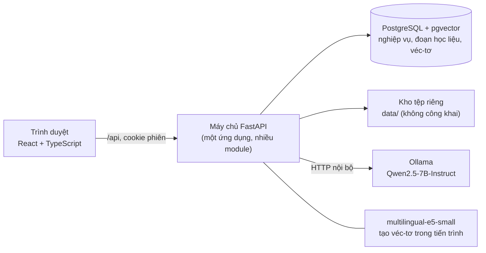
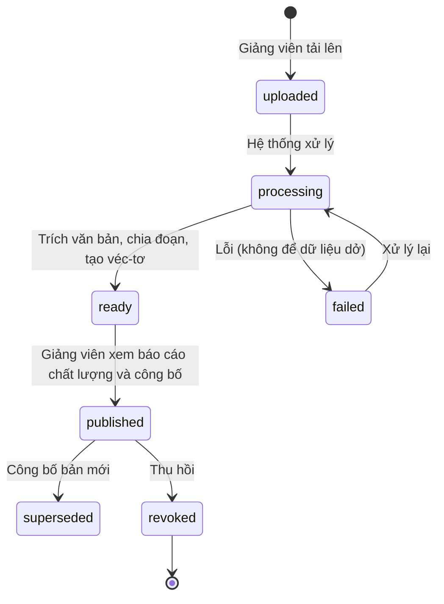
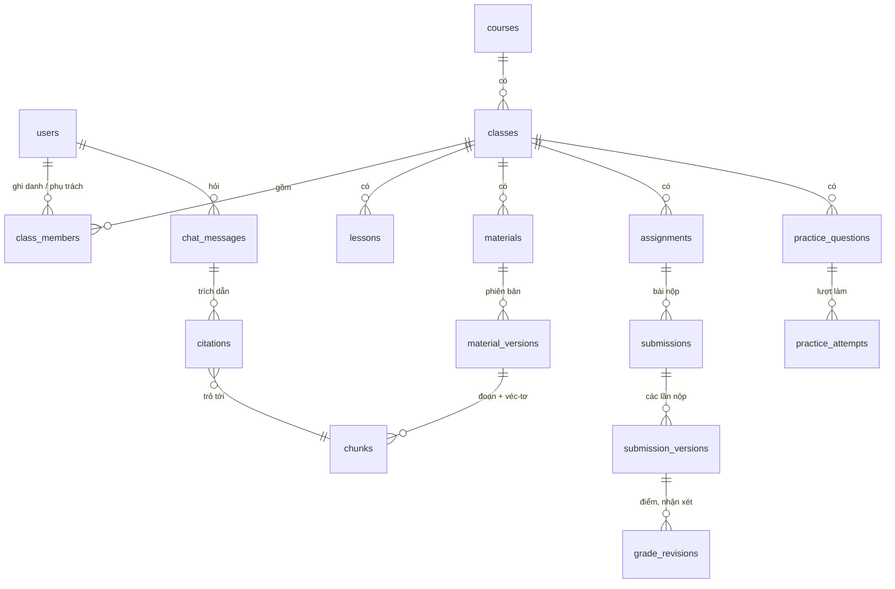

# DUTLearn — Tổng quan thiết kế (bản đọc nhanh)

Tài liệu tóm tắt để nắm hệ thống trong khoảng một giờ. Chi tiết chuẩn nằm ở [CONTRACT_V0.md](CONTRACT_V0.md); khi hai tài liệu khác nhau, theo hợp đồng.

## 1. Hệ thống gồm những gì



- **Một ứng dụng máy chủ** chia module: `auth`, `admin`, `courses`, `materials`, `ingest`, `rag`, `tutor`, `assignments`, `practice`, `progress`. Không tách nhiều dịch vụ vì quy mô một lớp thử nghiệm.
- **Mô hình AI chạy cục bộ**: học liệu không gửi ra ngoài; không tốn phí API.
- **Tệp học liệu** không nằm trong thư mục công khai; chỉ mở qua API có kiểm quyền.

## 2. Ai làm được gì

| Việc | Sinh viên | Giảng viên (lớp mình) | Quản trị |
| --- | --- | --- | --- |
| Xem lớp, bài học | Lớp đã ghi danh, đang mở | Lớp phụ trách | Không mặc nhiên |
| Đọc học liệu | Bản đã công bố | Mọi bản của lớp | Không mặc nhiên |
| Hỏi trợ giảng | Có — chỉ trên học liệu được phép đọc | Có | Không |
| Tải, công bố, thay, thu hồi học liệu | — | Có | — |
| Giao bài, chấm, công bố điểm | Nộp bài, xem điểm đã công bố | Có | — |
| Câu luyện tập | Làm câu đã công bố | Duyệt câu AI đề xuất, công bố | — |
| Tài khoản, môn, lớp, ghi danh | — | — | Có |

Nguyên tắc: **máy chủ kiểm quyền trên mọi yêu cầu**; người ngoài lớp nhận lỗi "không tìm thấy" (không biết lớp/tài liệu có tồn tại); giao diện chỉ ẩn/hiện, không phải lớp bảo vệ.

## 3. Luồng chính: đọc → hỏi → mở nguồn

```mermaid
sequenceDiagram
  actor SV as Sinh viên
  participant W as Giao diện
  participant API as Máy chủ
  participant DB as CSDL
  participant AI as Mô hình
  SV->>W: Hỏi khi đang đọc trang 133
  W->>API: POST /tutor/ask (lớp, tài liệu, trang, câu hỏi)
  API->>API: Kiểm phiên và quyền trên lớp
  API->>DB: Tìm đoạn liên quan, CHỈ trong học liệu đã công bố của lớp
  alt Không đoạn nào đủ gần
    API-->>W: "Chưa đủ căn cứ" (không gọi mô hình)
  else Có đoạn phù hợp
    API->>AI: Câu hỏi + các đoạn đánh số [1..k]
    AI-->>API: Câu trả lời có số nguồn
    API->>API: Bỏ số nguồn không có thật; kiểm lại tài liệu chưa bị thu hồi
    API-->>W: Câu trả lời + danh sách nguồn (tài liệu, trang, đoạn trích)
  end
  SV->>W: Bấm nguồn [1]
  W->>API: Mở nguồn (kiểm quyền lần nữa)
  W-->>SV: Trình đọc nhảy tới trang, tô vàng đoạn trích
```

## 4. Vòng đời học liệu



Chỉ bản **published** của lớp mới được trợ giảng dùng. Thu hồi có hiệu lực ngay vì truy vấn luôn lọc theo bản đang công bố; câu trả lời cũ dựa trên nguồn đã thu hồi bị ẩn với sinh viên.

## 5. Dữ liệu chính



## 6. Những quyết định cần hiểu để bảo vệ

| Quyết định | Lý do ngắn |
| --- | --- |
| Phiên đăng nhập lưu ở máy chủ, không dùng JWT | Đăng xuất/khóa tài khoản có hiệu lực ngay |
| Lọc quyền ngay trong câu truy vấn tìm kiếm | Không thể lộ đoạn của lớp khác hay bản đã thu hồi |
| Không lưu bộ nhớ đệm câu trả lời | Tránh lộ dữ liệu giữa người dùng và phiên bản |
| Ngưỡng "chưa đủ căn cứ" trước khi gọi mô hình | Giảm bịa nguồn (đã thấy ở phép thử EX01) |
| Hai cách tìm: theo nghĩa và kết hợp từ khóa | Câu hỏi nghiên cứu của đề tài; từ khóa giúp tên hàm/biến trong mã |
| AI chỉ tạo bản nháp câu luyện tập | Giảng viên quyết định nội dung và điểm |
| Tiến độ tách "hoạt động" và "kết quả" | Mở tài liệu không có nghĩa là đã hiểu bài |
